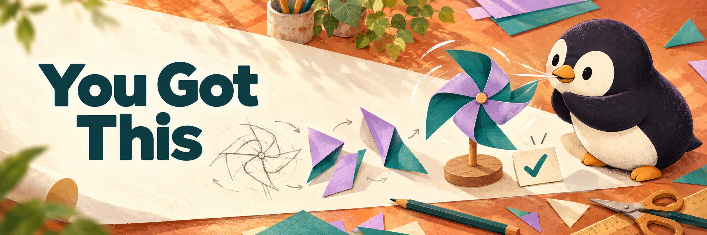

# Preserved You Got This design work

The maintainer selected this light/dark paper-atelier pair for the standalone README on 2026-10-23. It remained uncommitted before the retirement migration. The exact images and generation prompts are preserved here; they are historical design assets, not an alternative maintained landing page or Cookbook banner.

[Dark companion](banner-paper-v2-dark.png) · [Light prompt](banner-paper-v2.prompt.txt) · [Dark edit prompt](banner-paper-v2-dark.prompt.txt) · [Hashes and rights](SOURCES.json)

The original handoff records Chromium checks at 1280, 390 and 320 px in both themes, including currentSrc, loading and no overflow. Those are historical local preview observations, not current GitHub acceptance or measured software results. All preview HTML and captures, the earlier purple illustration, original process illustration and full handoff notes remain in the independent retirement backup; published originals also remain in the imported history.

Reusable design lesson: use the profile image for penguin identity, then choose a project-specific setting, composition and palette. Native picture/source media selection needs both theme paths checked; preserve an accessible fallback image.

Current workflow, installation and website: [Cookbook](https://github.com/pengusto/cookbook) · [Open the book](https://pengusto.github.io/cookbook/). See [migration record](../../docs/you-got-this-import.md).
